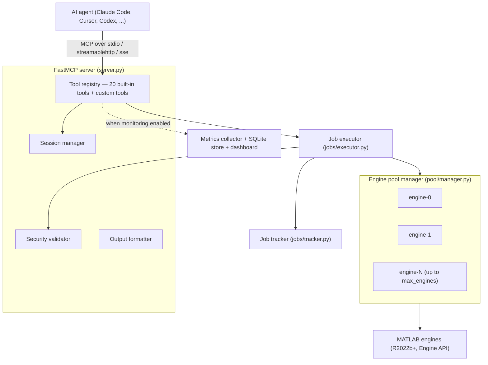

# Architecture

How the MATLAB MCP Server is put together: the layers, how a request flows through them, the key abstractions (engine pool, job lifecycle, session isolation), and the transports it speaks.

For the running package this describes: Python 3.10–3.12, MATLAB R2022b+ with the Engine API, FastMCP 3.4.4. See [Installation](Installation) to get it running and [Configuration](Configuration) for every config key.

## System overview

An MCP-compatible agent connects over a transport (stdio or HTTP). The FastMCP server routes each tool call to an implementation, which — for code that touches MATLAB — goes through security validation, the job executor, and finally an engine borrowed from the pool.



## Layers

Each layer lives in its own package under `src/matlab_mcp/`. The `MatlabMCPServer` state container (`server.py`) constructs and wires them together.

### Server (`server.py`)

The entry point and composition root.

- `create_server(config)` builds the `FastMCP` instance, registers all tools, and installs the lifespan context manager.
- The `lifespan()` async context manager handles startup (create directories, start the engine pool, wire monitoring, launch background health-check and cleanup loops) and graceful shutdown (stop the collector, drain running jobs up to `drain_timeout_seconds`, stop the pool).
- `main()` is the `matlab-mcp` console-script entry point: it parses CLI flags, loads config, configures logging, and runs the server in the selected transport.
- Two background loops run for the server's lifetime: engine health checks (every `pool.health_check_interval` seconds) and session/job/metrics cleanup (every 60 seconds).

### Engine pool (`pool/`)

Manages the lifecycle of MATLAB engine instances. See [Engine pool](#engine-pool) below.

- `pool/manager.py` — `EnginePoolManager`: acquire/release, on-demand scale-up, idle scale-down, health-driven replacement.
- `pool/engine.py` — `MatlabEngineWrapper`: wraps a single `matlab.engine` instance with a state machine and lazy Engine API import.

### Jobs (`jobs/`)

Orchestrates one code execution from creation to completion.

- `jobs/executor.py` — `JobExecutor`: security-checks code, acquires an engine, injects job context, runs the code with hybrid sync/async promotion, and releases the engine.
- `jobs/tracker.py` — `JobTracker`: thread-safe in-memory store of `Job` objects; prunes terminal jobs after `sessions.job_retention_seconds`.
- `jobs/models.py` — the `Job` dataclass and `JobStatus` enum with a validated state machine.

### Sessions (`session/manager.py`)

`SessionManager` maps a session ID to a `Session` (its own temp directory and activity timestamps). Under stdio a single `"default"` session is used; under the HTTP transports a per-client session is created from the request context. Idle sessions are expired after `sessions.session_timeout` (unless they still have active jobs). Session IDs are sanitized to prevent path traversal.

### Security (`security/validator.py`)

`SecurityValidator` runs before any engine work:

- **Function blocklist** — scans code for blocked functions (`system`, `unix`, `dos`, `!`, `eval`, `feval`, `evalc`, `evalin`, `assignin`, `perl`, `python`, `str2func`, `builtin`, `run` by default), stripping string literals and comments first to avoid false positives. A hit raises `BlockedFunctionError`.
- **Filename sanitization** — prevents path traversal in upload/read/delete filenames.
- **Upload size limits** — enforces `security.max_upload_size_mb`.

The validator is passed into the `JobExecutor`, so every code path (core, custom, and discovery tools) is checked centrally.

### Tools (`tools/`)

The MCP tool implementations, grouped by responsibility: `core.py` (execute/check/workspace), `jobs.py`, `discovery.py`, `files.py`, `admin.py`, `monitoring.py`, and `custom.py` (YAML-defined tools). The server registers 20 built-in tools plus any custom tools. See [MCP-Tools-Reference](MCP-Tools-Reference) for the full list.

### Output (`output/`)

Formats raw MATLAB results into MCP responses — text truncation, workspace-variable summaries, and figure conversion (MATLAB figures to Plotly JSON plus a static PNG and optional thumbnail).

### Monitoring (`monitoring/`)

Optional. A `MetricsCollector` samples pool/job/session/system stats on an interval and records events; a `MetricsStore` persists history to SQLite (`monitoring.db_path`, pruned after `retention_days`); a Starlette dashboard app serves `/dashboard` and `/health`. See [Configuration](Configuration) for the `monitoring` section. Requires the `monitoring` extra (psutil + uvicorn).

### Config (`config.py`)

Pydantic models for every section, `load_config()`, and `MATLAB_MCP_*` environment-variable overrides. Relative paths are resolved relative to the config file's directory. Unknown keys are ignored. See [Configuration](Configuration).

## Request data flow

### Synchronous execution

Most calls finish inline within `execution.sync_timeout` (default 30s).

```
Agent → execute_code("x = magic(3)")
  → resolve session + temp dir
  → SecurityValidator.check_code()            # blocked-function scan
  → JobExecutor.execute()
      → create Job (status=PENDING)
      → pool.acquire()                        # borrow an engine, mark BUSY
      → inject job context into workspace
      → engine.execute(code, background=True)
      → future completes before sync_timeout
      → build result, mark Job COMPLETED
      → pool.release()                        # reset workspace, mark IDLE
  → return {status: "completed", output, variables, ...}
```

### Async promotion

If a job is still running when `sync_timeout` elapses, the executor returns a `job_id` and keeps running in the background. The agent then polls.

```
Agent → execute_code("long_simulation()")
  → ... executor starts background run
  → sync_timeout elapses, still running
  → return {status: "pending", job_id: "j-<uuid>"}
  → get_job_status(job_id)   → running (+ progress if reported)
  → get_job_status(job_id)   → completed
  → get_job_result(job_id)   → full result
      (engine is released when the background job finishes)
```

`cancel_job` cancels a pending/running job; `list_jobs` lists jobs for the session.

## Key abstractions

### Engine pool

`EnginePoolManager` holds every engine in `_all_engines` and keeps idle engines in an `asyncio.Queue`.

- **Startup** — starts `pool.min_engines` engines in parallel; each start is bounded by `pool.engine_start_timeout`.
- **Acquire** — returns an idle engine immediately if one is queued; otherwise, if `total < pool.max_engines`, it scales up by starting a new engine under a lock; otherwise it blocks until one is released.
- **Release** — resets the engine's workspace (`clear all`, `clear global`, `clear functions`, `fclose all`, `restoredefaultpath`, re-add paths, re-run startup commands), marks it IDLE, and returns it to the queue. If the reset fails, the engine is flagged for replacement instead of being trusted.
- **Health checks** — the background loop runs a trivial `eval("1")` on each idle engine; unresponsive engines are stopped and replaced. Engines idle beyond `pool.scale_down_idle_timeout` are stopped and removed, never below `pool.min_engines`.

> The pool scales **up on demand** at acquire time and **down** during health checks. There is no separate proactive-warmup step. (`pool.proactive_warmup_threshold` appears in the shipped `config.yaml` but is not a modeled config field and has no effect.)

Each engine (`MatlabEngineWrapper`) is a small state machine:

```
STOPPED → STARTING → IDLE ⇄ BUSY
```

The `matlab.engine` module is imported lazily, so the server (and its tests) can run without MATLAB present — for example under `--inspect`, which starts with `min_engines = 0` and skips the pool entirely.

### Job lifecycle

A `Job` (`jobs/models.py`) carries `job_id` (`j-<uuid>`), `session_id`, `code`, timing fields, and either a `result` or an `error`. Transitions are enforced against a table so terminal states are final:

```
PENDING → RUNNING → COMPLETED
   │          ├────→ FAILED
   └──────────┴────→ CANCELLED
```

Terminal statuses are `COMPLETED`, `FAILED`, and `CANCELLED`. The `JobTracker` retains terminal jobs for `sessions.job_retention_seconds` (default 24h) so agents can still fetch results, then prunes them.

### Session isolation

Each session owns a temp directory; uploaded files, generated data, and `.m` scripts live there and file tools are scoped to it. When `execution.workspace_isolation` is true, the engine workspace is reset on every release, so sessions never see each other's variables. stdio uses one `"default"` session; the HTTP transports derive a per-client session from the request context (falling back to `client_id` when `session_id` is unavailable).

## Transports

Selected via `server.transport` or the `--transport` flag. The choices are `stdio`, `sse`, and `streamablehttp`.

| Transport | Use | Endpoint | Notes |
|-----------|-----|----------|-------|
| `stdio` (default) | Local single-client agents (Claude Code, Cursor) | stdin/stdout | No network; monitoring served on a separate port (8766). |
| `streamablehttp` | **Recommended** HTTP transport | `http://<host>:<port>/mcp` | FastMCP streamable-http; honors `server.stateless_http`. |
| `sse` | **Deprecated**, back-compat only | `http://<host>:<port>/sse` | Logs a deprecation warning at startup; will be removed. |

- **Ports** — the MCP server listens on `server.port` (default 8765) for the HTTP transports. The monitoring dashboard/health endpoints are on `monitoring.http_port` (8766) **only under stdio**; under the HTTP transports they are mounted on the main app instead (`/health`, `/dashboard`, `/metrics`, ...).
- **Auth** — the HTTP transports support an optional bearer token via the `MATLAB_MCP_AUTH_TOKEN` environment variable, enforced by `BearerAuthMiddleware`. If it is unset, all HTTP requests are accepted and a warning is logged. `/health` and CORS pre-flight `OPTIONS` bypass auth. Generate a token with `matlab-mcp --generate-token`. See [Security](Security).
- CORS is applied on the HTTP transports using `server.cors_origins`.

## See also

- [Installation](Installation) — Pixi, `install.bat`, pip, Docker
- [Configuration](Configuration) — every `config.yaml` section and env override
- [MCP-Tools-Reference](MCP-Tools-Reference) — the full tool reference
- [Configuration](Configuration) — monitoring config: dashboard, metrics, health
- [Security](Security) — blocked functions, auth, sandboxing
